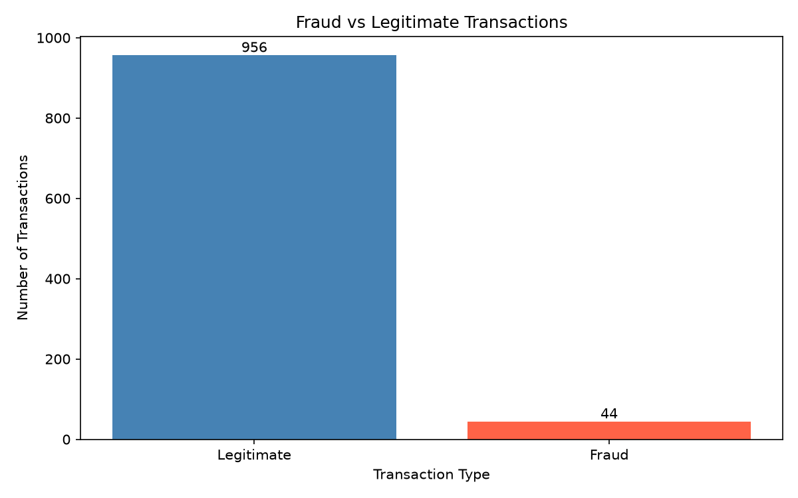
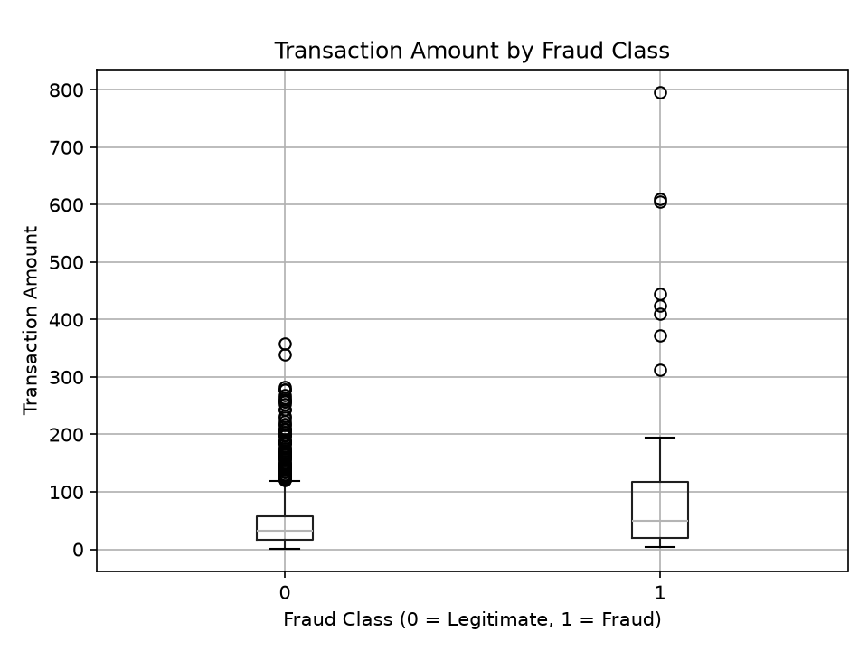
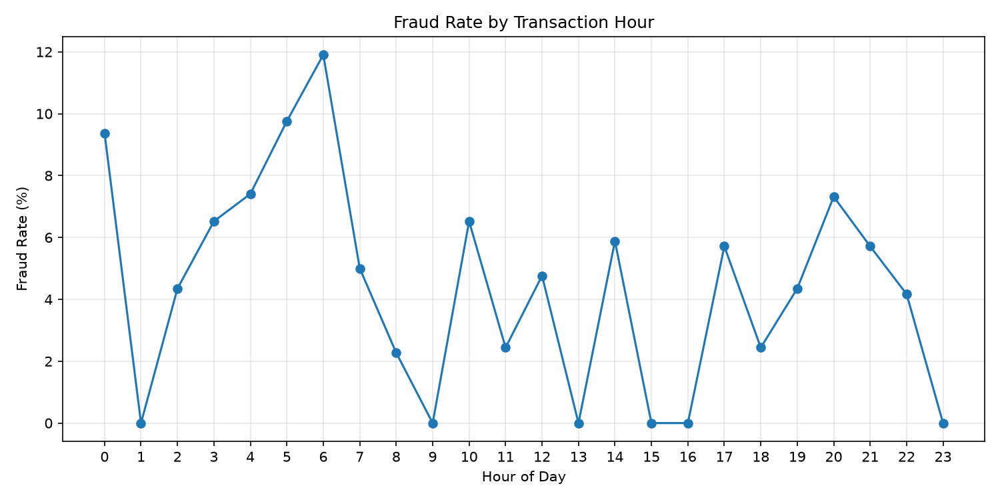
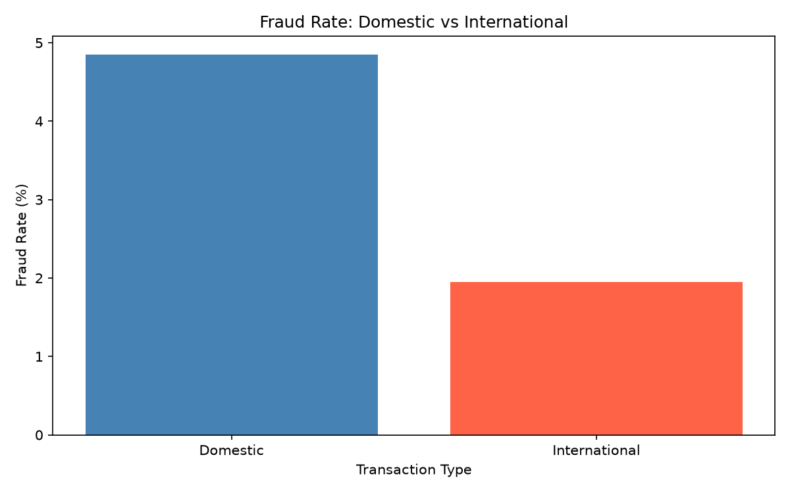

# Fraud Detection ML Pipeline

An end-to-end machine learning project for detecting
fraudulent financial transactions.

## Project Overview

This project demonstrates how to build a fraud detection
pipeline using Python and machine learning.

## Day 1: Data Generation and Visualization

Generated 1,000 synthetic financial transactions.

### Dataset Results

- Total transactions: 1,000
- Legitimate transactions: 956 (95.6%)
- Fraudulent transactions: 44 (4.4%)

### Technologies

- Python
- NumPy
- Pandas
- Matplotlib
- Scikit-learn (planned for model training)

### Project Structure

- `src/generate_data.py` - Generates synthetic data
- `src/visualize_data.py` - Creates fraud visualization
- `data/transactions.csv` - Synthetic dataset
- `results/fraud_distribution.png` - Fraud distribution chart

### Visualization



## How to Run

Install dependencies:

```bash
pip install -r requirements.txt
```

Generate transactions:

```bash
python src/generate_data.py
```

Create visualization:

```bash
python src/visualize_data.py
```

## Next Steps

- Exploratory data analysis
- Feature engineering
- Train machine learning models
- Evaluate precision, recall, and F1-score
- Build an inference pipeline


## Day 2: Exploratory Data Analysis

Performed exploratory data analysis on 1,000
synthetic financial transactions.

### Analysis Performed

- Inspected dataset shape and data types
- Checked missing values
- Checked duplicate transaction IDs
- Calculated descriptive statistics
- Compared transaction amounts by fraud class
- Analyzed fraud rates by transaction hour
- Compared domestic and international transactions

### Key Findings

- Total transactions: 1,000
- Legitimate transactions: 956
- Fraudulent transactions: 44
- Overall fraud rate: 4.40%
- Domestic fraud rate: 4.85%
- International fraud rate: 1.95%

These findings describe synthetic data and
should not be interpreted as real-world fraud trends.

### Visualizations

#### Transaction Amount by Fraud Class



#### Fraud Rate by Hour



#### Domestic vs International Fraud Rate



### Run Day 2 Analysis

```bash
python src/exploratory_analysis.py
```
